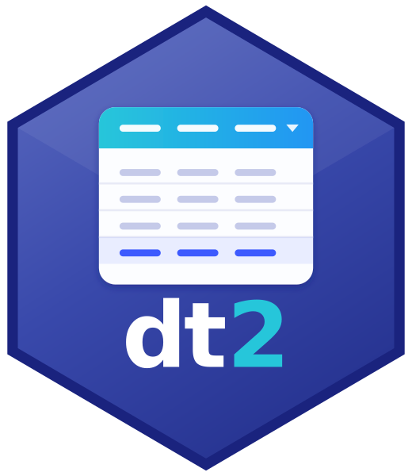

# dt2 — DataTables v2 for Shiny for Python 

<!-- badges: start -->
[](https://github.com/StrategicProjects/dt2py/actions/workflows/ci.yml)
[](https://pypi.org/project/dt2/)
[](https://pypi.org/project/dt2/)
[](https://strategicprojects.github.io/dt2py/)
[](LICENSE)
[](https://github.com/StrategicProjects/DT2)
[](https://doi.org/10.5281/zenodo.21365753)
<!-- badges: end -->

A Python port of the R [**DT2**](https://github.com/StrategicProjects/DT2)
package: an [anywidget](https://anywidget.dev) binding for
[DataTables v2](https://datatables.net), designed for
[Shiny for Python](https://shiny.posit.co/py/) (and usable in Jupyter).

It configures DataTables via plain Python (1:1 with the JS API), reusing the
same DataTables runtime (2.3.4) and extensions as the R package.

[DataTables](https://datatables.net) is developed by
[SpryMedia Ltd](https://sprymedia.co.uk/) and MIT licensed; all table
rendering, ordering, searching, paging and the extensions are its work. dt2 is
an independent binding and is not affiliated with, sponsored by or endorsed by
SpryMedia Ltd. See [License and third-party code](#license-and-third-party-code).

📖 **Documentation:** <https://strategicprojects.github.io/dt2py/> ·
📦 **PyPI:** <https://pypi.org/project/dt2/>

> Status: **feature-complete toward R parity, pre-release.** Config, all 15
> extensions, server-side processing, proxy, events and inline inputs are
> implemented and unit-tested. The live in-browser Comm transport has not yet
> been visually verified. See [ROADMAP.md](ROADMAP.md) and [CHANGELOG.md](CHANGELOG.md).

## Install (dev)

```bash
npm install && npm run build        # build the JS bundle into src/dt2/static/
uv venv && uv pip install -e ".[shiny,pandas]"
```

(The built bundle is committed, so an installed wheel needs no Node toolchain.)

## Quick start

```python
import pandas as pd
from shiny import App, ui
from shinywidgets import output_widget, render_widget
from dt2 import dt2

df = pd.read_csv("data.csv")

app_ui = ui.page_fluid(output_widget("tbl"))

def server(input, output, session):
    @render_widget
    def tbl():
        return dt2(df, select=True, pageLength=10)

app = App(app_ui, server)
```

## Configure with `Options`

Chainable builder mirroring the R pipe helpers:

```python
from dt2 import Options, JS, dt2

opts = (Options(df)
        .cols_align(["revenue"], "right")
        .format_number(["revenue"], thousands=".", decimal=",", digits=2, prefix="R$ ")
        .format_datetime(["updated"], from_="YYYY-MM-DD", to="DD/MM/YYYY")
        .cols_render(["score"], JS("function(d,t){ return t==='display' ? d+'%' : d; }"))
        .order(("revenue", "desc"))
        .length_menu([10, 25, -1]))

dt2(df, options=opts)
```

`JS(...)` is the parity for `htmlwidgets::JS()`: the source is revived into a
real function in the browser, with `DataTable`, `$` and `moment` in scope.

## Extensions

All 15 DataTables extensions are bundled; activate via `Options`:

```python
opts = (Options(df)
        .buttons(["copyHtml5", "csvHtml5", "excelHtml5"])  # jszip bundled; PDF needs pdfmake
        .select({"style": "os"})
        .responsive()
        .fixed_header()
        .row_group("field"))
```

`dt2.extensions()` lists what is bundled.

## Server-side processing

Keep large data Python-side; DataTables fetches pages over the Comm:

```python
dt2(big_df, server_side=True, pageLength=25)
```

Filtering/ordering/paging run in `dt2.server.process_ssp`.

## Proxy, events and inline inputs

```python
# proxy (Python -> table): call on the rendered widget
tbl.widget.search("ada")
tbl.widget.order(("field", "desc"))
tbl.widget.select_rows([1, 3])

# events (table -> Python): read reactively
from shinywidgets import reactive_read
reactive_read(tbl.widget, "selected_rows")  # also: state, row_check, row_button

# inline row inputs
opts = Options(df).col_checkbox("select", value_col="active").col_button("act", label="Ping")
```

See [`examples/`](examples/) for runnable apps:
`app.py`, `app_config.py`, `app_extensions.py`, `app_serverside.py`,
`app_proxy_inputs.py`.

## How it relates to the R package

The DataTables runtime is shared conceptually with R DT2. What differs is the
**transport**: R talks to Shiny via `window.Shiny`; here the widget talks to the
Python kernel over the anywidget Comm, bridged to Shiny reactivity by
`shinywidgets`. The `htmlwidgets::JS()` mechanism becomes the `JS()` marker +
client-side reviver. See the header of `js/index.js` for the full mapping.

## Authors

- **André Leite** (maintainer) — Universidade Federal de Pernambuco
- **Hugo Vasconcelos** — Universidade Federal de Pernambuco
- **Diogo Bezerra** — Universidade Federal de Pernambuco
- **Marcos Wasiliew**
- **Carlos Amorim** — Universidade Federal de Pernambuco
- **Júlia Nascimento Barreto**

## License and third-party code

MIT © André Leite (see [`LICENSE`](LICENSE)).

The package ships a pre-built JavaScript/CSS bundle (`src/dt2/static/`) that
contains third-party code, which remains the copyright of its authors:

| Component (bundled version) | Copyright holder | License |
|---|---|---|
| [DataTables](https://datatables.net/) 2.3.4 and 15 extensions (Buttons, ColReorder, ColumnControl, DateTime, FixedColumns, FixedHeader, KeyTable, Responsive, RowGroup, RowReorder, Scroller, SearchBuilder, SearchPanes, Select, StateRestore), with their Bootstrap 5 integration files | SpryMedia Ltd | MIT |
| [jQuery](https://jquery.com/) 3.7.1 | OpenJS Foundation and other contributors | MIT |
| [JSZip](https://stuk.github.io/jszip/) 3.10.1 (includes [pako](https://github.com/nodeca/pako)) | Stuart Knightley, David Duponchel, Franz Buchinger, António Afonso | MIT (dual MIT / GPL-3.0, used under MIT) |
| [Moment.js](https://momentjs.com/) 2.30.1 | JS Foundation and other contributors | MIT |
| [FileSaver.js](https://github.com/eligrey/FileSaver.js) 1.3.3 (inside Buttons) | Eli Grey | MIT |
| [Lucide](https://lucide.dev/) icons (inside ColumnControl) | Lucide Contributors; Cole Bemis (Feather) | ISC / MIT |

Exact versions and the full license notices are in
[`THIRD-PARTY-NOTICES`](THIRD-PARTY-NOTICES), which is included in the sdist
and in the wheel.

dt2 is not affiliated with, sponsored by or endorsed by SpryMedia Ltd.
DataTables is developed by SpryMedia Ltd.
